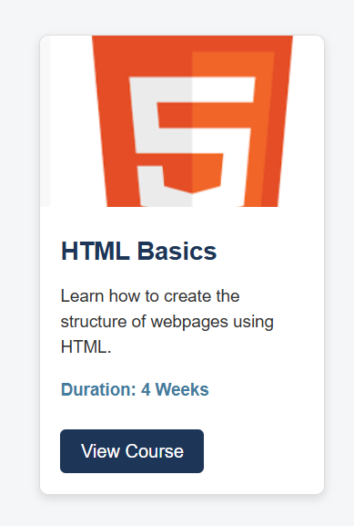
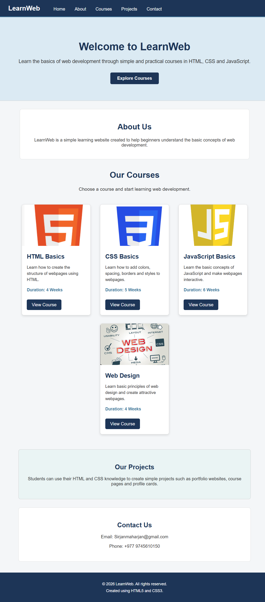

# HTML & CSS Practical Assignment

## Student Information

**Student Name:** Sirjan Maharjan

**Student ID:** 2602412499

**Module Name:** CIS092-1 Fundamentals Of Software Engineering - Computing

**Assignment Title:** Designing a Navigation Bar and Card Components Using HTML & CSS


---

## 1. Project Description

This project is a basic HTML and CSS webpage containing a navigation bar, multiple course cards, and a complete webpage layout.

The website was created using HTML5 and CSS3. It demonstrates the use of HTML structure and basic CSS concepts such as selectors, colors, fonts, margins, padding, borders, images, buttons and hover effects.

The project was created without using Flexbox, CSS Grid, Bootstrap, Tailwind CSS or JavaScript.


---

## 2. Technologies Used

- HTML5
- CSS3


---

## 3. Project Features

The webpage contains:

- Navigation bar
- Website name
- Home link
- About link
- Courses link
- Projects link
- Contact link
- Navigation hover effect
- Welcome section
- About section
- Four course cards
- Images
- Course information
- Buttons
- Button hover effects
- Projects section
- Contact section
- Footer


---

# 4. Learning Resources

## 4.1 Teacher's Material

**Resource:** Teacher's lecture notes

**Topic Learned:** HTML structure and CSS selectors

**What I Learned:**

I learned how HTML elements are used to create the structure of a webpage. I also learned how CSS selectors can be used to style different HTML elements.

**How I Used It:**

I used HTML elements such as header, nav, main, section, div and footer to structure my webpage. I also used element and class selectors in my CSS file.


---

## 4.2 University Learning Material

**Resource:** University learning materials

**Topic Learned:** HTML elements and CSS properties

**What I Learned:**

I learned how HTML elements provide structure to a webpage and how CSS properties can change the appearance of those elements.

**How I Used It:**

I used HTML5 elements to create the webpage structure and CSS properties to add colors, spacing, borders, fonts and other styles.


---

## 4.3 YouTube Tutorial

**Resource:** YouTube

**Topic Learned:** Navigation bar and card design

**What I Learned:**

I learned how navigation links can be styled using CSS and how cards can be created using HTML and CSS.

**How I Used It:**

I created my own navigation bar and course cards using the concepts I learned. I changed the design and content to create my own version.


---

## 4.4 MDN Web Docs

**Resource:** MDN Web Docs

**Topic Learned:** CSS Box Model

**What I Learned:**

I learned that the CSS box model consists of content, padding, border and margin. I understood that padding creates space inside an element while margin creates space outside an element.

**How I Used It:**

I used padding and margin to create spacing around the navigation bar, sections and cards. I also used borders to separate and style different parts of the webpage.


---

# 5. Screenshots

## Navigation Bar


## Single Card




## Multiple Cards


## Complete Website




---

# 6. What I Learned

During this assignment, I learned how to create a basic webpage using HTML5 and CSS3.

Some of the main concepts I learned are:

- HTML page structure
- Semantic HTML
- HTML elements
- CSS selectors
- Class selectors
- Colors
- Background colors
- Font properties
- Text properties
- Width and height
- Margin
- Padding
- Borders
- Border radius
- Image styling
- Button styling
- Hover effects
- Basic alignment
- Creating navigation bars
- Creating card components


I also learned that CSS margin and padding are different. Padding creates space inside an element, while margin creates space outside an element.


---

# 7. Challenges and Solutions

## Challenge 1: Styling the Navigation Bar

**Challenge:**

At first, the navigation links did not have enough spacing and the navigation bar did not look organized.

**Solution:**

I used margin and padding to create proper spacing between the website name and navigation links. I also used background colors and a hover effect to improve the navigation bar.


## Challenge 2: Making the Cards Look Consistent

**Challenge:**

It was difficult to make all the cards have a similar size and appearance.

**Solution:**

I created one common CSS class called `course-card` and applied the same styling to all four cards. This helped keep the cards consistent.


## Challenge 3: Image Size

**Challenge:**

The images were different sizes and did not fit the cards properly.

**Solution:**

I used CSS width, height and the `object-fit` property to make the images fit inside the card area.


---


# 8. Project Structure

```text
html-css-assignment/
│
├── index.html
│
├── css/
│   └── style.css
│
├── images/
│   ├── html.jpg
│   ├── css.jpg
│   ├── javascript.jpg
│   └── web-design.jpg
│
├── screenshots/
│   ├── navigation-bar.png
│   ├── single-card.png
│   ├── multiple-cards.png
│   └── complete-page.png
│
└── README.md
```


---

# 9. Conclusion

This assignment helped me understand how HTML and CSS work together to create a webpage.

I learned how to structure a webpage using HTML and style it using CSS. I also practiced creating navigation links, cards, buttons, images, spacing, borders and hover effects.

The assignment also helped me understand how to learn from different resources and apply the knowledge to my own project.